# Hotel Reservation System (SQL Assignment III)
**Name:** Samuel Alier  
**Student ID:** 202510491  
**DBMS:** PostgreSQL (pgAdmin 4)  
**Database:** `samuel_202510491_hotel_reservation_system_database`
## 1. Project overview
A small hotel database. It stores guests, rooms, and the reservations that link a guest to a room.
## 2. Tables and relationships
**guests** (guest_id, full_name, phone, nationality). Primary key: guest_id.
**rooms** (room_id, room_number, room_type, price_per_night). Primary key: room_id.
**reservations** (reservation_id, guest_id, room_id, check_in, nights, status). Primary key: reservation_id. Foreign keys: guest_id to guests, room_id to rooms.
One guest can have many reservations, and one room can be reserved many times. The primary keys are generated automatically. The foreign keys make sure a reservation always points to a real guest and a real room.

## 3. Creating the database and tables
```sql
CREATE DATABASE samuel_202510491_hotel_reservation_system_database;
```
```sql
CREATE TABLE guests (
    guest_id    INT GENERATED ALWAYS AS IDENTITY PRIMARY KEY,
    full_name   VARCHAR(100) NOT NULL,
    phone       VARCHAR(15)  UNIQUE,
    nationality VARCHAR(50)
);
```
```sql
CREATE TABLE rooms (
    room_id         INT GENERATED ALWAYS AS IDENTITY PRIMARY KEY,
    room_number     VARCHAR(10) NOT NULL UNIQUE,
    room_type       VARCHAR(20) NOT NULL CHECK (room_type IN ('Single', 'Double', 'Deluxe')),
    price_per_night INT         NOT NULL CHECK (price_per_night > 0)
);
```
```sql
CREATE TABLE reservations (
    reservation_id INT GENERATED ALWAYS AS IDENTITY PRIMARY KEY,
    guest_id       INT         NOT NULL REFERENCES guests(guest_id),
    room_id        INT         NOT NULL REFERENCES rooms(room_id),
    check_in       DATE        NOT NULL,
    nights         INT         NOT NULL CHECK (nights > 0),
    status         VARCHAR(20) NOT NULL DEFAULT 'Confirmed'
                   CHECK (status IN ('Confirmed', 'Checked-in', 'Completed', 'Cancelled'))
);
```
## 4. Initial data
I inserted 5 guests, 6 rooms and 5 reservations. Parents first, then reservations.
```sql
INSERT INTO guests (full_name, phone, nationality) VALUES
('Alice Uwase',          '0788100001', 'Rwandan'),
('John Smith',           '0788100002', 'British'),
('Grace Wanjiru',        '0788100003', 'Kenyan'),
('Patrick Okello',       '0788100004', 'Ugandan'),
('Marie Claire Ingabire','0788100005', 'Rwandan');
```
```sql
INSERT INTO rooms (room_number, room_type, price_per_night) VALUES
('101', 'Single', 40000),
('102', 'Single', 40000),
('201', 'Double', 70000),
('202', 'Double', 70000),
('301', 'Deluxe', 120000),
('302', 'Deluxe', 120000);
```
```sql
INSERT INTO reservations (guest_id, room_id, check_in, nights, status) VALUES
(1, 1, '2026-10-10', 3, 'Completed'),
(2, 3, '2026-10-15', 2, 'Completed'),
(3, 5, '2026-10-20', 4, 'Checked-in'),
(4, 2, '2026-11-01', 5, 'Confirmed'),
(1, 4, '2026-11-10', 2, 'Confirmed');
```
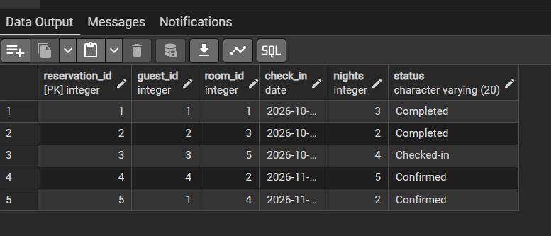
## 5. SQL tasks
(The before and verify queries are in `assignment_iii.sql`.)
SELECT
Q1.1. I selected the name, phone and nationality of every guest.
```sql
SELECT full_name, phone, nationality
FROM guests;
```
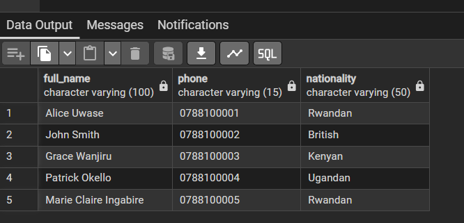
Q1.2. I used WHERE to show only the Deluxe rooms.
```sql
SELECT room_number, room_type, price_per_night
FROM rooms
WHERE room_type = 'Deluxe';
```
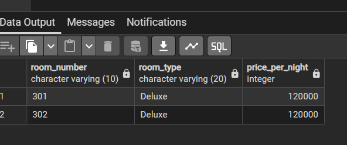
Q1.3. I used ORDER BY to list the rooms from the most expensive to the cheapest.
```sql
SELECT room_number, room_type, price_per_night
FROM rooms
ORDER BY price_per_night DESC, room_number ASC;
```
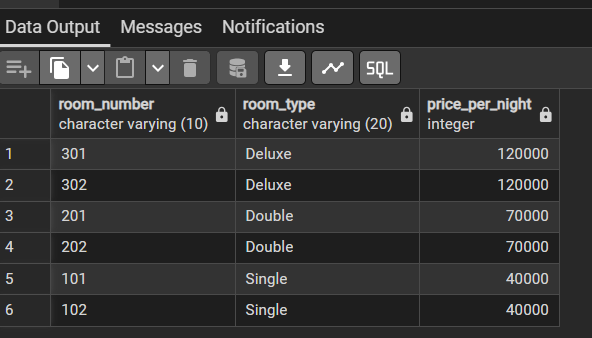
JOIN
Q2.1. INNER JOIN shows only the reservations that have a matching guest.
```sql
SELECT r.reservation_id, g.full_name, r.check_in, r.nights, r.status
FROM reservations r
INNER JOIN guests g ON r.guest_id = g.guest_id;
```
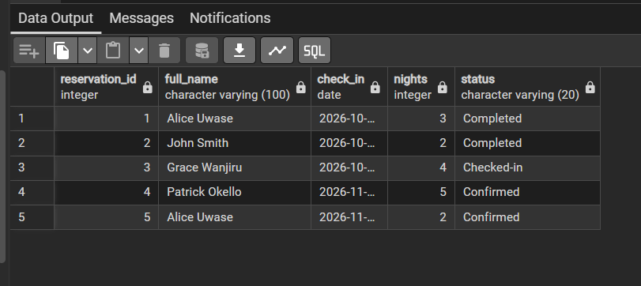
Q2.2. LEFT JOIN shows all guests. Marie Claire has no reservation, so her reservation columns are empty (NULL).
```sql
SELECT g.guest_id, g.full_name, r.reservation_id, r.check_in
FROM guests g
LEFT JOIN reservations r ON g.guest_id = r.guest_id
ORDER BY g.guest_id;
```
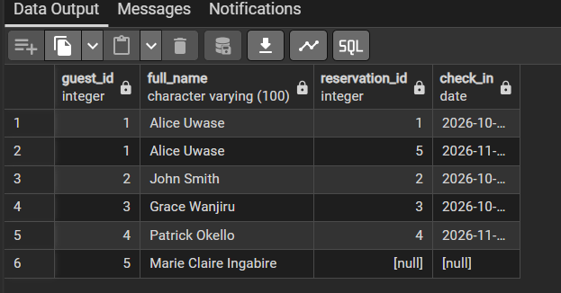
Q2.3. I joined reservations, guests and rooms to show who booked which room, and the total cost (nights x price).
```sql
SELECT g.full_name, ro.room_number, ro.room_type, r.check_in, r.nights,
       r.nights * ro.price_per_night AS total_cost
FROM reservations r
JOIN guests g  ON r.guest_id = g.guest_id
JOIN rooms  ro ON r.room_id  = ro.room_id
ORDER BY r.check_in;
```
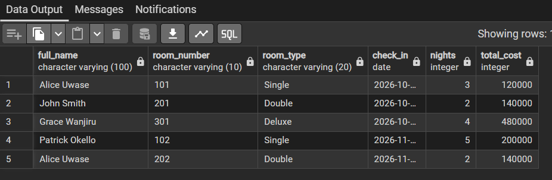
UPDATE
Q3.1. I changed the phone number of guest 2 only, using WHERE guest_id = 2.
```sql
UPDATE guests
SET phone = '0788999999'
WHERE guest_id = 2;
```

Q3.2. I added 10000 to the price of all Single rooms. Two rooms changed.
```sql
UPDATE rooms
SET price_per_night = price_per_night + 10000
WHERE room_type = 'Single';
```
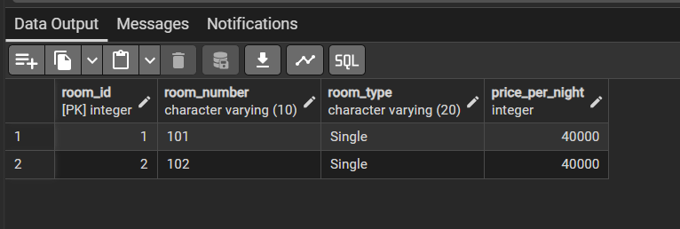
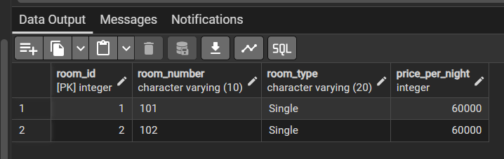
Q3.3. Confirmed reservations with a check-in on or before 5 Nov 2026 became Checked-in. Only reservation 4 matched.
```sql
UPDATE reservations
SET status = 'Checked-in'
WHERE status = 'Confirmed' AND check_in <= '2026-11-05';
```
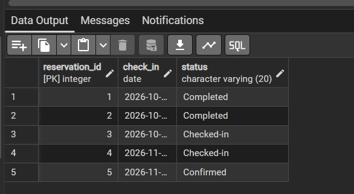
ALTER TABLE
Q4.1. I renamed the column nationality to country. The data stayed the same.
```sql
ALTER TABLE guests RENAME COLUMN nationality TO country;
```
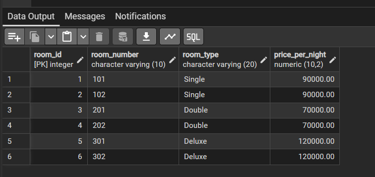
Q4.2. I changed the room price from INT to NUMERIC(10,2) so it can have decimals. The old prices stayed valid.
```sql
ALTER TABLE rooms ALTER COLUMN price_per_night TYPE NUMERIC(10,2);
```

Q4.3. I added an email column to guests. Old rows have NULL in it.
```sql
ALTER TABLE guests ADD COLUMN email VARCHAR(100);
```

INSERT
Q5.1. I added one new guest. The guest_id was generated by the database.
```sql
INSERT INTO guests (full_name, phone, country, email)
VALUES ('David Mugabo', '0788100006', 'Rwandan', 'david.mugabo@example.com');
```
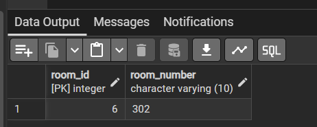
Q5.2. I added three new rooms with one INSERT statement.
```sql
INSERT INTO rooms (room_number, room_type, price_per_night) VALUES
('103', 'Single', 50000.00),
('203', 'Double', 75000.00),
('303', 'Deluxe', 130000.00);
```

Q5.3. I added a reservation for guest 5 in room 6. Both exist, so the foreign keys accepted it.
```sql
INSERT INTO reservations (guest_id, room_id, check_in, nights)
VALUES (5, 6, '2026-11-20', 3);
```
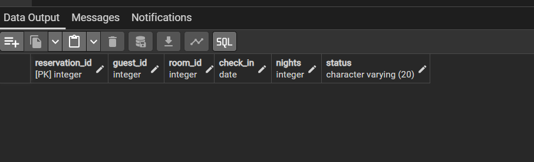
## 6. Conclusion
In this assignment I created a database with three related tables and used primary keys and foreign keys to connect them. I inserted data and read it back with SELECT. INNER JOIN shows only matching rows, and LEFT JOIN keeps the rows without a match. I learned to use WHERE in every UPDATE so that only the right rows change, and to check the result afterwards. With ALTER TABLE I changed the structure of a table without losing the data.
